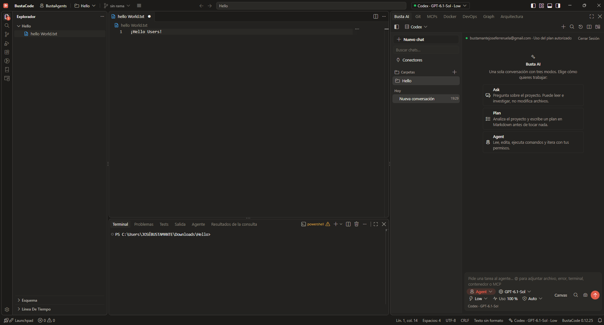
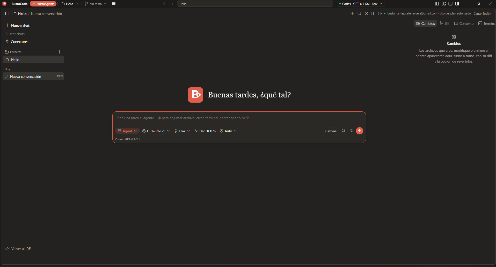

# BustaCode

### One IDE. Every agent. One workspace.

**A complete development environment with BustaAI, BustaAgents, Git, Docker, DevOps, Graph and Architecture — all in one place.**

**[⬇ Download BustaCode for Windows](https://github.com/sensodent/BustaCode-Releases/releases/latest)**

**Official website:** [bustacode.bustaos.com](https://bustacode.bustaos.com)

**🌐 English** · [🇪🇸 Español](README.es.md)

---

## Meet BustaCode

**BustaCode** is a desktop development environment built on [Code - OSS](https://github.com/microsoft/vscode). It combines a full-featured code editor with **BustaAI**, a unified experience for AI coding agents.

Work directly in the editor or focus on your agents. **No need to juggle separate apps and windows.**

## Two modes. The same BustaAI.

### BustaCode — Full IDE

Your editor, terminal, debugger, extensions, Git tools and BustaAI in the same workspace.

### BustaAgents — Agent-focused mode

Hide the traditional IDE and give BustaAI the spotlight. Chat with agents, track their work and review changes. Switch back to the editor at any time **without changing applications or losing the active conversation**.

> **BustaAgents is not a separate application.** It is a different view of the same BustaCode window, projects and conversations.

## What's inside?

| Feature | What you get |
| --- | --- |
| **BustaAI** | Unified chat, **Ask / Plan / Agent** modes and a consistent interface across supported providers. |
| **AI providers** | **Cursor** through its official CLI and ACP, **Codex** through its app-server, and **OpenAI API** integration. Each uses its own execution engine. |
| **Project memory** | Structured, editable context with project goals, decisions, instructions, relevant files and Git state. |
| **Parallel conversations** | Multiple agent chats in tabs, with separate status indicators and conversation history. |
| **Git & worktrees** | Review diffs, changes, branches, history, worktrees and pull-request workflows. |
| **MCP & tools** | Project-level MCP integrations through a local gateway with access controls. |
| **Docker & DevOps** | Explore containers and logs, and inspect Linux hosts over SSH: CPU, memory, services and network ports. |
| **Busta Graph** | Explore code relationships, dependencies, API routes, data models, DAOs and database tables. |
| **Architecture** | View project architecture diagrams created with agent assistance and Archify. |
| **Extensions** | Code - OSS extension compatibility with the [Open VSX](https://open-vsx.org/) registry and manual VSIX installation. |

## Get started

1. **[Download the latest Windows installer](https://github.com/sensodent/BustaCode-Releases/releases/latest).**
2. Install BustaCode and open a project.
3. Open **BustaAI**, then connect a supported provider. Switch between **BustaCode** and **BustaAgents** from the app.

BustaCode is **free to download**. Provider accounts, API keys, subscriptions, usage limits and any provider charges are **separate**. Cursor and Codex integrations rely on their respective official tools and authentication.

## Privacy, extensions and updates

- Project context and BustaAI's local state are managed on your device. Relevant context is sent to the **selected AI provider** when you make a request.
- Tool execution and permissions depend on the selected agent engine; BustaAI presents approval requests and activity information where supported.
- The extension gallery is **Open VSX**, **not Microsoft's Visual Studio Marketplace**. Some proprietary extensions may be unavailable.
- The updater verifies release manifests and installer integrity using cryptographic signatures and checksums.

## Support & community

- [Report a bug, ask a question or suggest a feature](https://github.com/sensodent/BustaCode-Releases/issues/new/choose)
- [FAQ](FAQ.md) · [Support](SUPPORT.md) · [Security](SECURITY.md)
- [Contributing](CONTRIBUTING.md) · [Code of Conduct](CODE_OF_CONDUCT.md) · [Accessibility](ACCESSIBILITY.md) · [License notice](LICENSE)

## Download and project status

**[Latest release](https://github.com/sensodent/BustaCode-Releases/releases/latest)** · [All releases](https://github.com/sensodent/BustaCode-Releases/releases)

- **Available installer:** Windows x64.
- **Source code:** currently private. This public repository distributes the application installers and update manifests, not the source.
- **Foundation:** [Code - OSS](https://github.com/microsoft/vscode) (MIT-licensed). BustaCode is an independent project and is not affiliated with Microsoft, Cursor, OpenAI or the other named providers.

---

**Code when you want to. Delegate when you need to.**

BustaCode · BustaAI · BustaAgents

**[Download BustaCode](https://github.com/sensodent/BustaCode-Releases/releases/latest)** · [Leer en español](README.es.md)

